<p align="center">
  
</p>

<p align="center">
  <a href="LICENSE.md"></a>
  
  
  
</p>

<p align="center">
  <a href="https://vigiadopovo.rafaelcouto111.workers.dev"><b>Abrir o site</b></a> ·
  <a href="#como-verificar">Como verificar</a> ·
  <a href="docs/tecnico.md">Documentação técnica</a> ·
  <a href="CONTRIBUTING.md">Contribuir</a>
</p>

> [!NOTE]
> **Projeto independente e aberto.** Não tem vínculo com a Câmara dos Deputados, partidos, governos ou empresas. Todo o código é público sob licença MIT, os dados vêm só de fontes oficiais, e cada número publicado pode ser conferido por qualquer pessoa.

## O que você encontra

|                      |                                                                                                  |
| -------------------- | ------------------------------------------------------------------------------------------------ |
| 📜 **Propostas**     | Projetos de lei recentes, com a ementa oficial explicada em linguagem simples.                   |
| 🗳️ **Votos**         | Cada voto registrado, com filtros por tema, partido, UF, deputado e posição.                     |
| 👤 **Deputados**     | Perfil de quem está em exercício e de quem já exerceu mandato, em cada legislatura desde 1826.   |
| 📊 **Métricas**      | Alinhamento com Governo e Oposição, votações por mês e votos por deputado, de 2003 até hoje.     |
| 🔍 **Transparência** | A página `/transparencia/` mostra a coleta que gerou cada número, com hashes e links das provas. |

## Do dado oficial até você

<p align="center">
  
</p>

Nada é digitado à mão e nenhuma IA gera números. Os resumos de ementa são marcados como texto de IA e nunca substituem a ementa oficial.

## Por que dá para confiar sem precisar confiar

| Pergunta                                 | Resposta                                                                       | Prova pública                                |
| ---------------------------------------- | ------------------------------------------------------------------------------ | -------------------------------------------- |
| O arquivo foi alterado depois da coleta? | Cada arquivo tem SHA-256 no manifesto da coleta.                               | `pipeline/v1/manifests/<hash>.json`          |
| Quem gerou o arquivo?                    | O workflow público `collect.yml`, num runner do GitHub, a partir de um commit. | Atestação Sigstore (`gh attestation verify`) |
| Quando?                                  | O hash do manifesto é carimbado num bloco do Bitcoin.                          | `pipeline/timestamps/<hash>.json.ots`        |
| As métricas seguem regras fixas?         | SQL público, recalculável a partir dos arquivos oficiais.                      | [`scripts/metrics.ts`](scripts/metrics.ts)   |
| O site publicado é o build atestado?     | `SHA256SUMS` lista o hash de cada arquivo do site e é atestado no deploy.      | `/SHA256SUMS`                                |

<details>
<summary><b>Mostrar a matemática</b></summary>

### Integridade: SHA-256

Cada artefato $x$ é guardado com a chave $H(x)$, em que $H$ é SHA-256. O manifesto $M$ lista $(\text{chave}, \text{tamanho}, H(x))$ de cada artefato e só é gravado depois de todos eles. Verificar é recalcular:

$$\text{válido}(x) \iff H(x) = h_x \text{ listado em } M$$

Encontrar $x' \neq x$ com $H(x') = H(x)$ exige cerca de $2^{128}$ operações (colisão) e não é viável. Mudar **um** byte muda o hash por completo.

### Origem: Sigstore

O GitHub assina $H(\text{arquivo})$ junto com a identidade do workflow, o repositório, o commit e a execução. A assinatura fica no log público de transparência (Rekor). Ela prova **qual código** gerou o arquivo, não que a Câmara está certa.

### Tempo: OpenTimestamps

O hash do manifesto entra numa árvore de Merkle cuja raiz vai para uma transação do Bitcoin. A prova `.ots` é o caminho $h \to \dots \to \text{raiz}$. Ela mostra que o manifesto já existia antes daquele bloco, sem carteira nem taxa.

### Métricas

Alinhamento do partido $p$ com a bancada $b$ (Governo, Oposição, Maioria ou Minoria) no ano $a$, contando só votações em que $b$ orientou Sim ou Não:

$$
\text{alinhamento}(p,b,a) = \frac{\left\lvert \lbrace v : \text{partido}(v)=p,\ \text{voto}(v)=\text{orientação}_b(v) \rbrace \right\rvert}{\left\lvert \lbrace v : \text{partido}(v)=p,\ \text{voto}(v) \in V \rbrace \right\rvert}
$$

em que $V$ = Sim, Não, Abstenção ou Obstrução. O partido é o registrado em cada voto, não o atual. Ausência nunca é contada como voto. Coincidir com uma orientação não significa apoiar o mérito.

Percentil do radar dos deputados (posição média em empates), entre os $n$ deputados em exercício:

$$
P(x) = \operatorname{round}\left(100 \cdot \frac{\left\lvert \lbrace y : y < x \rbrace \right\rvert + \tfrac{1}{2} \left\lvert \lbrace y : y = x \rbrace \right\rvert}{n}\right)
$$

Votação **nominal** é a que tem ao menos um registro individual de voto no arquivo oficial. Votações simbólicas contam só no total.

### O que isso não prova

- A API da Câmara não assina suas respostas: o hash prova que o arquivo não mudou depois da coleta, não que a fonte está correta.
- É preciso confiar nos runners do GitHub. Qualquer pessoa pode fazer um fork e rodar o mesmo workflow como testemunha independente.
- Registros inconsistentes da fonte (por exemplo, 23 linhas de mandatos sem nome e com outra legislatura) ficam de fora e são contados no arquivo, nunca adivinhados.

</details>

<details id="como-verificar">
<summary><b>Como verificar, passo a passo</b></summary>

**1. Recalcule uma métrica sem usar nada deste projeto.** Com [DuckDB](https://duckdb.org), direto nos arquivos oficiais:

```sql
WITH votos AS (
  SELECT unnest(dados, recursive := true)
  FROM read_json('https://dadosabertos.camara.leg.br/arquivos/votacoesVotos/json/votacoesVotos-2019.json', maximum_object_size = 500000000)
), orientacoes AS (
  SELECT unnest(dados, recursive := true)
  FROM read_json('https://dadosabertos.camara.leg.br/arquivos/votacoesOrientacoes/json/votacoesOrientacoes-2019.json', maximum_object_size = 500000000)
)
SELECT v.siglaPartido AS partido, count(*) AS votos,
       count(*) FILTER (WHERE v.voto = o.orientacao) AS alinhados
FROM votos v JOIN orientacoes o ON o.idVotacao = v.idVotacao
WHERE upper(o.siglaBancada) IN ('GOV.', 'GOVERNO')   -- a Câmara usou "GOV." até 2022
  AND o.orientacao IN ('Sim', 'Não')
  AND v.voto IN ('Sim', 'Não', 'Abstenção', 'Obstrução')
GROUP BY partido ORDER BY votos DESC LIMIT 3;
```

E compare com o site:

```sh
curl -s "https://vigiadopovo.rafaelcouto111.workers.dev/api/metricas/alinhamento?ano=2019&bancada=Governo" | jq '.linhas[:3]'
```

Os dois dão **PSL 10.793 / 10.530**, **PT 9.214 / 1.955** e **PSD 6.814 / 6.146**.

**2. Confira um arquivo do site:**

```sh
SITE=https://vigiadopovo.rafaelcouto111.workers.dev
REPO=c0utin/vigiadopovo
curl -fsSLO "$SITE/SHA256SUMS"
gh attestation verify SHA256SUMS -R "$REPO" --signer-workflow "$REPO/.github/workflows/deploy.yml"
curl -fsSL "$SITE/legislativo.json" -o legislativo.json
grep " legislativo.json$" SHA256SUMS | sha256sum -c -
```

**3. Confira a coleta e o carimbo:**

```sh
HASH=$(curl -fsSL "$SITE/transparencia/" | grep -o 'manifests/[0-9a-f]\{64\}' | head -1 | cut -d/ -f2)
curl -fsSLO "$SITE/pipeline/v1/manifests/$HASH.json"
echo "$HASH  $HASH.json" | sha256sum -c -
gh attestation verify "$HASH.json" -R "$REPO" --signer-workflow "$REPO/.github/workflows/collect.yml"
curl -fsSLO "$SITE/pipeline/timestamps/$HASH.json.ots" && npx -y -p opentimestamps@0.4.9 ots-cli.js verify -f "$HASH.json" "$HASH.json.ots"
```

O guia completo, com a conferência de cada artefato do manifesto, está em [VERIFY.md](VERIFY.md).

</details>

## Como funciona

| Peça     | Onde                                                                                            | Custo                                        |
| -------- | ----------------------------------------------------------------------------------------------- | -------------------------------------------- |
| Coleta   | GitHub Actions, todo dia às 06:00 (Brasília)                                                    | grátis                                       |
| Site     | Cloudflare Workers, páginas estáticas pré-renderizadas                                          | plano grátis                                 |
| Fotos    | Cloudflare R2                                                                                   | franquia grátis                              |
| Métricas | Lake medalhão (bronze, prata, ouro) em Iceberg no R2, escrito em Rust + Polars, lido com R2 SQL | franquia grátis, com trava automática em 80% |

O lake só acrescenta dados: cada arquivo oficial fica guardado como foi publicado (bronze), cada registro guarda todas as suas versões (prata) e cada métrica guarda o lote de arquivos de que saiu (ouro). Visitantes nunca disparam consultas ao banco: as métricas são calculadas uma vez por dia e servidas em cache. Detalhes, limites e configuração em [docs/tecnico.md](docs/tecnico.md).

## Rodar localmente

Node.js 22.17+ e pnpm 12.

```sh
pnpm install
pnpm dev          # site em modo de desenvolvimento
pnpm test && pnpm check && pnpm build
```

## Licença e créditos

Código sob [licença MIT](LICENSE.md): use, copie e modifique à vontade. Dados e documentos legislativos são da Câmara dos Deputados e mantêm seu regime jurídico. Fotos oficiais: Câmara dos Deputados. Veja [como contribuir](CONTRIBUTING.md) e a [política de segurança](SECURITY.md).
